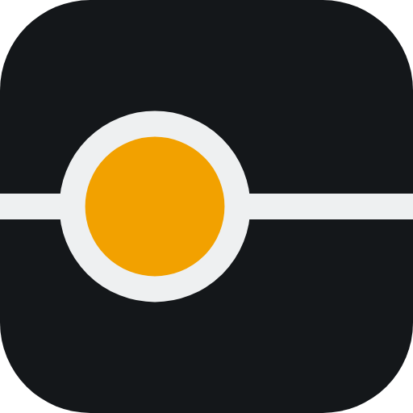

<div align="center">



<br /><br />

**Dot.Press: ideas deserve better presentations.**

<br />

   

**Part of the [InfoDot Ecosystem](https://github.com/sakhileb/InfoDot)** &nbsp;·&nbsp; `pres.infodot.co.za`

</div>

---

## What it is

A presentation platform built around one idea: a deck is an argument. The left rail of the editor, the Spine, is a line of beads, one per slide. A bead is hollow until its slide carries evidence for its claim, solid once it does, amber where you are. The same line is the progress indicator while presenting.

- **Editor.** Drag, resize, rotate, snap and align on a DOM canvas. Rich text in place. Shapes, icons, pictures with crop, masks and adjustments, video and audio, tables, and 14 chart types (bar, column, line, area, pie, doughnut, scatter, bubble, waterfall, funnel, radar, combo, KPI tiles, world map). Groups, layers, rulers, grid, guides. Undo and redo. Autosave that survives a closed tab, a dead network and a failed request.
- **Structure.** Sections, hidden slides, layouts that never delete your content, 12 themes, brand kits, 20 templates, slide sizes (16:9, 4:3, portrait, custom) with three ways to resize a finished deck.
- **Presenting.** Full screen player, presenter view with notes, timer and next slide, an audience window, a phone as a remote clicker, audience following by short polling, an offline single file present package. Transitions (fade, push, wipe, reveal, zoom, morph) and element animations in a click sequence.
- **Review.** A consistency inspector (fonts, colours, alignment, density, terminology, repeated content, unsupported claims) with fixes you apply one at a time, a story assistant for narrative structure, comments with mentions, review requests and approvals bound to the exact content, version history with restore.
- **Sharing.** Private, shared with named people, team, or an unlisted link with an optional password and expiry.
- **Import and export.** PowerPoint import and export written directly as OOXML (with native charts and tables), PDF (server side, and a browser print view for the highest fidelity), PNG images, the offline present package. Every export shows a preflight of what is native, approximated or not carried over.
- **AI, honestly.** With no model connected, every assistant runs deterministic local rules and says so. With `ANTHROPIC_API_KEY` configured the same services ask a model. Everything generated arrives as a proposal with a diff; nothing changes your deck until you accept it.

## How it works

- The deck is a document. Slides hold their elements as JSON and every change is an operation in an append-only log (`deck_changes`). Operations merge per element, so two people editing different elements never conflict. Changes arrive within seconds by short polling because the host has no websocket server. Two people editing the very same text box: the last edit wins. There is no live co-typing.
- Contract: `docs/programme/R40_DOCUMENT_SPEC.md`. Plan and decisions: `docs/programme/R40_PLAN.md`. Audit: `docs/programme/R40_AUDIT.md`. Design system: `DESIGN.md`. Readiness: `docs/programme/R40_READINESS.md`.
- Backend: Laravel 13, Sanctum, Jetstream teams, InfoDot sign-in. Frontend: Vue 3 and Inertia; slides are rendered as DOM and SVG by one renderer shared by the editor, thumbnails, the player and the print view. Charts come from one JavaScript engine with a PHP port for exports. Tiptap edits text.
- Integrations: InfoDot sign-in is the only live one. The other platforms were checked and have no data API Dot.Press could use; charts import from CSV, TSV and XLSX files (including Dot.Sheets exports) instead of linking live.

## Tech stack

| Layer | Technology |
|---|---|
| Framework | Laravel 13, PHP 8.4 |
| Frontend | Inertia.js with Vue 3, Tailwind CSS 4 for the account pages, hand-written CSS with tokens for the product (`resources/css/press`) |
| Rich text | Tiptap 3 |
| Database | SQLite, one file, in production too. Queue, cache and sessions use the database driver, in WAL mode with a busy timeout |
| Exports | DomPDF for PDF, direct OOXML for PPTX, client side PNG |
| Storage | Local disk, signed relative URLs, Range requests for media |
| Auth | Sanctum and Jetstream, InfoDot sign-in |
| Realtime | Short polling; no websockets |

## Run it

```bash
cp .env.example .env
composer install
npm install && npm run build
php artisan key:generate
touch database/database.sqlite
php artisan migrate
php artisan db:seed --class=PressDemoSeeder   # local only: owner@demo.test / password
php artisan serve
```

Tests: `php artisan test` (PHP) and `npm run test:press` (JavaScript, `node --test`).

## Tailwind CSS 4

Tailwind is v4, built by `@tailwindcss/vite` (`vite.config.js`). There is no `tailwind.config.js`, `postcss.config.js` or autoprefixer: everything that used to be config lives in `resources/css/app.css`.

- `@import 'tailwindcss' source(none)` plus five `@source` lines (the old `content` globs, nothing wider: automatic detection would scan `app/`, `docs/` and `tests/`), and `@plugin` for forms and typography. `dark:` is still the visitor's `prefers-color-scheme`, as in v3 (no `darkMode` was configured), so no `@custom-variant dark` is declared.
- **The migration's rule is no visual change.** Every v4 default that moved a pixel is put back, each with a comment in `app.css`: border colour (gray-200, not `currentColor`), pointer cursor on buttons, placeholder colour, `hover:` on touch screens, `ring` (3px blue-500/50), the `shadow`/`rounded`/`blur` scale renames and the `drop-shadow-lg` value, the transparent `outline-none`, the v3 `transition` property lists, sRGB gradient interpolation (v4 uses oklab), the `@tailwindcss/forms` focus rule beating plain `border-*` utilities (v4 moved the plugin into the base layer, under every utility), the browser's own spacing on `th`/`td`/`option`/`dialog`/the file button, `ltr:`/`rtl:` needing an explicit `dir`, the v3 `font-sans`/`font-mono` stacks (Figtree first; declared `@theme inline` because `Welcome.vue` and `AuthenticationCard.vue` define their own `--font-mono`), the v3 palette hex values (`resources/css/tailwind-v3-palette.css`; v4 moved to oklch) and the v3 colours of `prose`. Fix a difference in `app.css`, never by redesigning.
- Markup that changed because v4 dropped or reinterpreted it (no visual change): `ring-opacity-5` -> `ring-black/5` (Dropdown), `bg-opacity-25` -> `bg-gray-200/25` (the Jetstream welcome stub), `lg:grid-cols-[280px,1fr]` -> `lg:grid-cols-[280px_1fr]` (the editor; v4 no longer turns the comma into a space), `sm:leading-10` / `sm:leading-none` next to `sm:text-4xl` / `sm:text-5xl` on the welcome headings (in v4 an explicit `leading-*` beats a responsive `text-*` size's line height; in v3 the responsive size won), and `divide-y divide-white/[0.06]` -> `[&>*+*]:border-t [&>*+*]:border-white/[0.06]` on the dashboard deck list (v4's `divide-*` draws the line under every row but the last instead of above every row but the first, which moves the first and last row by 1px).
- Things v4 does differently that a view can trip over, not compensated: `space-x-*`/`space-y-*` and `divide-*` put the margin or border on every child but the LAST instead of every child but the first (a hidden last child leaves a trailing gap); `flex-shrink-*`/`flex-grow-*` are `shrink-*`/`grow-*`; `scale-*`, `translate-*` and `rotate-*` set their own properties, not `transform`; the important marker goes last; colours with an opacity modifier (`text-white/60`, `bg-black/10`) go through `color-mix()` in oklab, the same colour with up to 4/255 of channel rounding on a few antialiased pixels.
- `@tailwindcss/typography` still pins a flagged `postcss-selector-parser`; `package.json` `overrides` pins it to ^7.1.6 so `npm audit --audit-level=moderate` is clean. Leave it until the plugin itself moves.
- Browser floor: Chrome 111, Safari 16.4, Firefox 128 (cascade layers, `@property`, `color-mix`).

## Ecosystem

**Dot.Press** is one of **21 platforms** in the InfoDot ecosystem, connected via Sanctum SSO (each platform has its own database). Visit [InfoDot](https://github.com/sakhileb/InfoDot) to explore the full platform map.

## License

MIT © [SK Digital / BluPin Incorporated](https://github.com/sakhileb)
